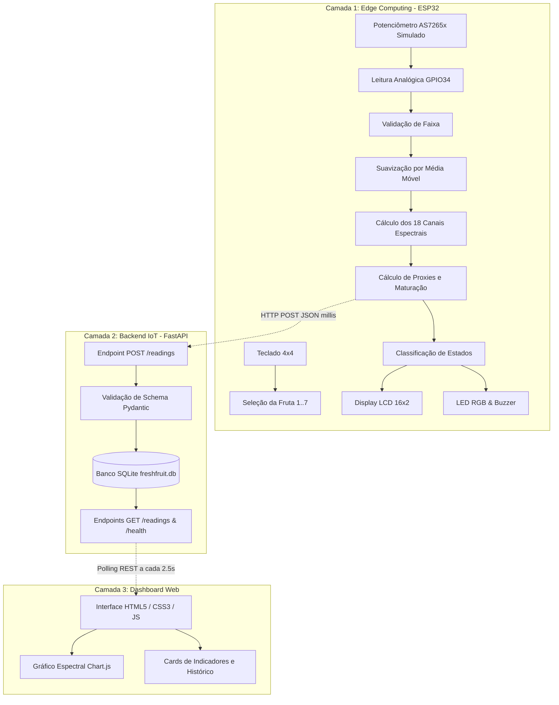

# Fresh Fruit — Monitoramento Espectral Vis-NIR e Maturação de Frutas

> **FIAP · Global Solution 2026.2 · CitizenTech**  
> **Disciplina:** Engenharia de Software  
> **Microcontrolador:** ESP32 DevKit v1  
> **Ambiente de Simulação:** Wokwi  

---

## 👥 Integrantes da Equipe

| Nome Completo | RM |
|---|---|
| **Antonio do Nascimento Ferreira de Sousa** | 573706 |
| **Guilherme Pereira Ruiz da Silva** | 573360 |
| **Gustavo Leal** | 569361 |
| **Matheus Mendes Duarte da Silva** | 569559 |
| **Matheus Sato Oliveira do Prado** | 569392 |

---

## 📖 1. Contextualização do Projeto

### 1.1. O que é o Fresh Fruit?
O **Fresh Fruit** é uma solução IoT baseada em **Edge Computing** que utiliza conceitos de **espectrometria Vis-NIR (Visible and Near-Infrared)** para estimar características físico-químicas relacionadas ao estágio de maturação de frutas.

A solução utiliza um microcontrolador **ESP32** para simular e processar dados espectrais de **18 canais** (baseados nas bandas do sensor multiespectral **AS7265x**, faixa de 410 nm a 940 nm), calculando indicadores heurísticos em tempo real e classificando o estado da fruta de forma 100% autônoma.

### 1.2. Problema que o Projeto Resolve
Feirantes, pequenos comerciantes e consumidores avaliam a qualidade e a maturação das frutas primordialmente por inspeção visual, tato e intuição. Essa abordagem gera desperdício de alimentos, perdas financeiras e divergências de percepção.

O Fresh Fruit democratiza a análise espectral, transformando dados ópticos invisíveis em métricas práticas:
- **Feirantes e Produtores:** Decisão rápida sobre ponto de venda ou precificação dinâmica.
- **Pequenos Comércios:** Organização de estoque e redução de perdas pós-colheita.
- **Cidadãos/Consumidores:** Compreensão clara da vida útil e do momento ideal de consumo.

### 1.3. Conexão com CitizenTech e ODS
O projeto atende diretamente ao pilar **CitizenTech** ao levar tecnologia de ponta e acessível para desafios urbanos cotidianos, priorizando a **autonomia total da borda (Edge Computing)**: o dispositivo continua medindo, calculando e alertando mesmo em locais sem conectividade ou internet.

- **ODS 2 (Fome Zero e Agricultura Sustentável):** Redução de perdas na cadeia de distribuição de alimentos.
- **ODS 12 (Consumo e Produção Responsáveis):** Minimização do desperdício de alimentos perecíveis.

---

## 🔬 2. Fundamentos da Espectrometria e Indicadores

### 2.1. Sensor de Referência: AS7265x (18 Canais)
O sensor de referência AS7265x disponibiliza 18 canais ópticos distribuídos entre o visível e o infravermelho próximo:
`410, 435, 460, 485, 510, 535, 560, 585, 610, 645, 680, 705, 730, 760, 810, 860, 900, 940 nm`

### 2.2. Indicadores Calculados na Borda (ESP32)

No protótipo **não há sensor físico**: o **potenciômetro ligado ao GPIO 34 simula a reflectância espectral** que seria medida pelo AS7265x. **Todos os indicadores derivam desse único valor**, seguindo este fluxo:

1. O ADC do ESP32 lê o potenciômetro (0 a 4095).
2. Uma média móvel de 5 amostras suaviza a leitura (uma nova leitura a cada 400 ms).
3. O valor suavizado é normalizado: `n = ADC / 4095`, onde `0` representa fruta verde e `1`, fruta passada.
4. A partir de `n`, o firmware gera os 18 canais espectrais (assinatura espectral sintética) e calcula os cinco indicadores, ajustados à faixa de cada fruta.
5. O índice de maturação é comparado aos limiares da fruta para definir o estágio e o estado (NORMAL, ATENÇÃO ou CRÍTICO).

| Indicador | Banda de referência no sensor real | Cálculo no protótipo (`n = ADC / 4095`) |
|---|---|---|
| **Proxy de Clorofila** | Razão entre o pico de absorção em 680 nm e a banda Red-Edge (730 nm) | `clorofila_máx − n × (clorofila_máx − clorofila_mín)`; diminui conforme `n` aumenta |
| **Proxy de Sólidos Solúveis (°Brix)** | Bandas NIR de 810 a 860 nm | `brix_mín + n × (brix_máx − brix_mín)` |
| **Proxy de Umidade Relativa (%)** | Bandas de 900 a 940 nm | `88 − 22 × n` |
| **Índice de Maturação (0% a 100%)** | Composição dos indicadores espectrais | `n × 100`; os limiares de classificação variam por fruta |
| **Vida Útil Estimada (dias)** | Heurística sobre a maturação | `(1 − n) × vida_útil_máx` |

As faixas de °Brix, clorofila e vida útil máxima de cada fruta estão na tabela da Seção 3.

> **Importante:** neste protótipo os 18 canais gerados a partir de `n` servem para visualização no dashboard e para a transmissão ao backend; **eles não alimentam o cálculo dos indicadores**. Com um sensor AS7265x real, o caminho se inverte: os canais medidos passam a ser a entrada, e os indicadores são calculados a partir das razões entre as bandas indicadas na coluna "Banda de referência".

> **⚠️ Limitação Científica:** Os indicadores são estimativas heurísticas demonstrativas educacionais. Em um produto comercial de campo, seriam necessárias calibrações laboratoriais com espectrofotômetros de bancada, controle rigoroso de iluminância e geometria de medição.

---

## 🍓 3. Frutas Contempladas e Teclado 4x4

O sistema permite a seleção instantânea de 7 frutas através do teclado matricial:

| Tecla | Fruta | Faixa Ideal (°Bx) | Clorofila | Vida Útil Máx. |
|:---:|:---|:---:|:---:|:---:|
| **1** | **Banana** | 8.0 – 22.0 | 15.0 – 90.0 | ~7 dias |
| **2** | **Manga** | 7.0 – 18.0 | 20.0 – 85.0 | ~10 dias |
| **3** | **Mamão** | 6.0 – 15.0 | 18.0 – 80.0 | ~8 dias |
| **4** | **Maçã** | 10.0 – 17.0 | 10.0 – 70.0 | ~20 dias |
| **5** | **Uva** | 12.0 – 24.0 | 12.0 – 65.0 | ~12 dias |
| **6** | **Laranja** | 8.0 – 14.0 | 25.0 – 80.0 | ~15 dias |
| **7** | **Abacate** | 4.0 – 10.0 | 30.0 – 95.0 | ~9 dias |
| **#** | **Confirmar Seleção** | Inicia a análise espectral da fruta escolhida |
| **\*** | **Cancelar / Reset** | Retorna ao estado inicial de aguardo |

---

## 🔌 4. Componentes do Circuito e Pinagem

| Componente | Pino do Componente | Pino no ESP32 | Finalidade |
|---|---|---|---|
| **Potenciômetro** | SIG | `GPIO 34` (ADC1_CH6) | Simulador de variação de reflectância espectral |
| **Potenciômetro** | VCC / GND | `3V3` / `GND` | Alimentação |
| **Keypad 4x4 (Linhas)** | R1, R2, R3, R4 | `GPIO 13, 14, 18, 19` | Varredura de linhas do teclado |
| **Keypad 4x4 (Colunas)**| C1, C2, C3, C4 | `GPIO 25, 26, 27, 32` | Varredura de colunas do teclado |
| **LCD 16x2 I2C** | SDA | `GPIO 21` | Linha de dados I2C (Endereço 0x27) |
| **LCD 16x2 I2C** | SCL | `GPIO 22` | Linha de clock I2C |
| **LCD 16x2 I2C** | VCC / GND | `5V` / `GND` | Alimentação do display |
| **LED RGB (Cátodo)** | R (Vermelho) | `GPIO 4` (via 220Ω) | Alerta crítico ou atenção |
| **LED RGB (Cátodo)** | G (Verde) | `GPIO 16` (via 220Ω) | Indicação de condição normal/madura |
| **LED RGB (Cátodo)** | B (Azul) | `GPIO 17` (via 220Ω) | Estado de espera / seleção |
| **LED RGB (Cátodo)** | Cátodo Comum | `GND` | Referência |
| **Buzzer** | POS (+) | `GPIO 23` | Alarme sonoro pulsante no estado crítico |
| **Buzzer** | NEG (-) | `GND` | Referência |

---

## 🏗️ 5. Arquitetura em 3 Camadas



---

## 🚦 6. Lógica de Funcionamento e Estados de Borda

O firmware opera sob máquina de estados não-bloqueante controlada por `millis()`:

1. **Estado Aguardando (IDLE):** LED Azul aceso. LCD solicita seleção de 1 a 7 e tecla `#`.
2. **Estado Normal (NORMAL):** Fruta madura e no ponto ideal de consumo. LED Verde aceso. LCD exibe índice de maturação e °Brix. Buzzer desligado.
3. **Estado de Atenção (ATENÇÃO):** Fruta verde (imaturo) ou muito madura (consumo rápido). LED Amarelo (Vermelho + Verde).
4. **Estado Crítico (CRÍTICO):** Fruta passada / deteriorada. LED Vermelho aceso. Buzzer aciona alarme sonoro pulsante.
5. **Estado de Falha (FALHA):** Leitura fora dos limites operacionais. LED pisca em Magenta.

---

## 🚀 7. Como Executar e Testar o Projeto

O Fresh Fruit tem três partes que rodam localmente: o **backend** (FastAPI), o **dashboard** (HTML/JS) e o **firmware** do ESP32, simulado com o **Wokwi para VS Code**. A ordem abaixo permite validar cada etapa antes de seguir para a próxima:

| Etapa | O que faz | Como confirmar que funcionou |
|---|---|---|
| 1. Backend | Sobe a API e o banco SQLite | `/health` responde no navegador |
| 2. Dashboard | Exibe os dados da API | Badge "Backend conectado" |
| 3. Teste sem hardware | Envia uma leitura pelo simulador do dashboard | A leitura aparece no painel e no histórico |
| 4. Firmware | Gera o binário que o Wokwi executa | Arquivo `.merged.bin` na pasta `build/` |
| 5. Simulação | Roda o ESP32 virtual | Banner no monitor serial e mensagem no LCD |
| 6. Integração | O ESP32 envia leituras ao backend | `[HTTP] Sucesso` no serial e leituras do `ESP32-FRESHFRUIT-01` no dashboard |

> Para validar apenas a API e a interface, as etapas 1 a 3 bastam: elas não dependem do Wokwi.

### 7.1. Pré-requisitos

- [Visual Studio Code](https://code.visualstudio.com/) com a extensão **Wokwi for VS Code**. A extensão exige uma licença ativada: pressione `F1` e execute **Wokwi: Request a New License**.
- **Python 3.10 ou superior** (`python --version` para conferir).
- **Arduino IDE 2** com o pacote de placas **esp32 (Espressif Systems)**, necessário apenas para gerar o firmware (etapa 4).
- Navegador atualizado (Chrome, Edge ou Firefox).
- Git, para clonar o repositório.

### 7.2. Obter o projeto

```bash
git clone https://github.com/gprsilva/FreshFruit.git
```

Abra a pasta `FreshFruit` no VS Code (`File > Open Folder`). Ela deve ser a raiz do workspace, com `diagram.json`, `sketch.ino` e `wokwi.toml` visíveis no Explorer. Todos os comandos a seguir partem dessa raiz.

### 7.3. Etapa 1: Backend (FastAPI)

Abra um terminal no VS Code (`Ctrl + '`) na raiz do projeto.

1. Instale as dependências:

   ```bash
   python -m pip install -r backend/requirements.txt
   ```

2. Crie o arquivo de ambiente a partir do exemplo:

   ```bash
   cp backend/.env.example backend/.env
   ```

   A chave de API (`x-api-key`) deve ser a mesma no backend, no `sketch.ino` e no `dashboard/app.js`. Se alterar o valor no `.env` (veja os nomes das variáveis em `.env.example`), atualize os outros dois arquivos.

3. Inicie o servidor:

   ```bash
   python -m uvicorn backend.main:app --host 127.0.0.1 --port 8000 --reload
   ```

   Execute **na raiz do repositório**, e não dentro de `backend/`: os módulos usam imports relativos e, de dentro da pasta, o Python falha com `ImportError: attempted relative import with no known parent package`.

**Resultado esperado:** o terminal mostra `Uvicorn running on http://127.0.0.1:8000`, e `http://127.0.0.1:8000/health` responde no navegador. A documentação interativa fica em `http://127.0.0.1:8000/docs`.

Mantenha esse terminal aberto durante todos os testes.

### 7.4. Etapa 2: Dashboard

Abra um **segundo terminal** na raiz do projeto e sirva a pasta do dashboard:

```bash
python -m http.server 5500 --directory dashboard
```

Acesse `http://127.0.0.1:5500`. Alternativa: clique com o botão direito em `dashboard/index.html` e escolha **Open with Live Server**, caso a extensão esteja instalada.

**Resultado esperado:** o badge no topo mostra **Backend conectado**. Se mostrar "Backend desconectado", confirme que a etapa 1 está rodando na porta 8000 (o endereço usado pelo dashboard é a constante `API_BASE_URL` no início do `app.js`).

### 7.5. Etapa 3: Testar API e dashboard sem o ESP32

1. No dashboard, clique em **Simular leitura**.
2. Escolha uma fruta e um estágio de maturação.
3. Clique em **Enviar leitura**.

**Resultado esperado:** o painel principal, o gráfico espectral e o histórico são atualizados, com o dispositivo `SIMULADOR-WEB-01`. Isso confirma que a API recebe, grava no SQLite e devolve os dados, independentemente do ESP32.

### 7.6. Etapa 4: Gerar o firmware

A extensão do Wokwi para VS Code **não compila o código**: ela executa um binário já compilado. Se a pasta `build/` já estiver no repositório e você não alterou o `sketch.ino`, pule para a etapa 5. Caso contrário, gere o binário:

1. No Arduino IDE 2, instale as bibliotecas em `Tools > Manage Libraries`: **LiquidCrystal I2C**, **Keypad** e **ArduinoJson**.
2. Abra o `sketch.ino` e selecione a placa em `Tools > Board > esp32`: **ESP32 Dev Module**.
3. Execute `Sketch > Export Compiled Binary`.

   O Arduino IDE exige que o sketch esteja numa pasta com o mesmo nome do arquivo. Se ele oferecer criar a pasta `sketch/`, aceite e, depois da exportação, copie a pasta `build/` gerada para a raiz do projeto (ou ajuste os caminhos abaixo).

4. Confira os arquivos gerados em `build/esp32.esp32.esp32/`: `sketch.ino.bin`, `sketch.ino.merged.bin` e `sketch.ino.elf`.
5. Aponte o `wokwi.toml` para o binário **merged**, que inclui bootloader e tabela de partições:

   ```toml
   [wokwi]
   version = 1
   firmware = "build/esp32.esp32.esp32/sketch.ino.merged.bin"
   elf = "build/esp32.esp32.esp32/sketch.ino.elf"
   ```

   Os caminhos são relativos à pasta do `wokwi.toml`. O `libraries.txt` serve ao editor online (wokwi.com) e não é usado pela extensão do VS Code.

### 7.7. Etapa 5: Executar a simulação no Wokwi

1. Abra o `diagram.json`.
2. Pressione `F1` e execute **Wokwi: Start Simulator**.
3. Abra o monitor serial da simulação para acompanhar as mensagens.

**Resultado esperado:** o monitor serial exibe o banner "FRESH FRUIT" com a lista de integrantes, o LCD mostra "FRESH FRUIT / GS 2026.2 FIAP" e depois "Selecione Fruta: 1..7 e tecle #", e o LED RGB fica azul (estado IDLE).

### 7.8. Teste de maturação

1. Pressione uma tecla de `1` a `7` para escolher a fruta (a tabela da Seção 3 mostra o mapeamento).
2. Pressione `#` para confirmar.
3. Ajuste o potenciômetro: como ele simula a reflectância espectral (Seção 2.2), valores mais altos representam frutas mais maduras.
4. Observe o LCD (alterna entre maturação/estado e °Brix/vida útil/umidade), o LED RGB, o buzzer e o monitor serial.
5. Pressione `*` para cancelar e voltar ao estado inicial.

Exemplo com **Banana** (tecla `1`), cujos limiares são 45%, 80% e 92% de maturação:

| Posição do potenciômetro (aprox.) | Estágio | Estado | LED | Buzzer |
|---|---|---|---|---|
| Abaixo de 45% | Imaturo / Verde | ATENÇÃO | Amarelo | Desligado |
| Entre 45% e 80% | Maduro / Ideal | NORMAL | Verde | Desligado |
| Entre 80% e 92% | Muito Maduro | ATENÇÃO | Amarelo | Desligado |
| Acima de 92% | Passado / Deteriorado | CRÍTICO | Vermelho | Pulsante |

### 7.9. Etapa 6: Integração ESP32 e backend

A cada 4 segundos, depois de uma fruta confirmada com `#`, o firmware envia um `POST` com a leitura em JSON para `http://host.wokwi.internal:8000/readings`, usando o cabeçalho `x-api-key`. O endereço `host.wokwi.internal` aponta para o computador que executa o Wokwi e depende do **Wokwi IoT Gateway**, recurso que, conforme a documentação do Wokwi, pode exigir um plano com acesso ao gateway. A rede Wi-Fi simulada é a `Wokwi-GUEST`.

**Resultado esperado:** o monitor serial mostra `[HTTP] Sucesso no envio ao Backend!` com o código HTTP, e o dashboard passa a exibir leituras do dispositivo `ESP32-FRESHFRUIT-01`.

Se o backend estiver inacessível, o monitor serial mostra `[HTTP] Backend inacessivel ou erro de conexao`, mas o ESP32 **continua funcionando de forma autônoma** (classificação, LCD, LED e buzzer), como prevê a abordagem de Edge Computing. Nesse caso, a integração da API e do dashboard continua demonstrável pelo simulador da etapa 3. Leituras do simulador web (`SIMULADOR-WEB-01`) não devem ser confundidas com medições enviadas pelo dispositivo.

### 7.10. Solução de problemas

| Sintoma | Causa provável | Solução |
|---|---|---|
| `ImportError: attempted relative import with no known parent package` | Uvicorn executado dentro de `backend/` | Voltar à raiz e usar `python -m uvicorn backend.main:app ...` |
| `Address already in use` na porta 8000 | Outro processo usa a porta | Encerrar o processo ou usar outra porta, ajustando `API_BASE_URL` (dashboard) e `BACKEND_URL` (firmware) |
| Dashboard mostra "Backend desconectado" | Backend parado ou em outra porta | Conferir a etapa 1 e abrir `/health` no navegador |
| `Wokwi: firmware binary ... not found in workspace` | Caminho do `wokwi.toml` errado ou binário não gerado | Conferir se o arquivo existe no caminho indicado, relativo à pasta do `wokwi.toml`, e se o VS Code abriu a raiz do projeto |
| Simulação reinicia sem parar (`rst:0x3 (SW_RESET)` repetido no serial) | Binário sem bootloader | Usar `sketch.ino.merged.bin` no `wokwi.toml` e placa **ESP32 Dev Module** na exportação |
| Erro de compilação por biblioteca ausente | Bibliotecas não instaladas no Arduino IDE | Instalar `LiquidCrystal I2C`, `Keypad` e `ArduinoJson` |
| `[HTTP] Backend inacessivel` no serial | Backend desligado ou gateway do Wokwi indisponível | Confirmar a etapa 1 e validar a API pelo simulador do dashboard (etapa 3) |
| `[WIFI] Aviso: Wi-Fi offline` na inicialização | Conexão demorou mais que o tempo de espera | Comportamento previsto: o ESP32 segue autônomo |

### 7.11. Encerramento

1. Pare a simulação do Wokwi (`F1` e **Wokwi: Stop Simulator**).
2. Em cada terminal aberto (backend e dashboard), pressione `Ctrl + C`.

---

## 📁 Estrutura de Arquivos

```
FreshFruit/
├── diagram.json                 # Diagrama de circuito Wokwi
├── sketch.ino                   # Firmware C++/Arduino para ESP32
├── libraries.txt                # Bibliotecas externas do Wokwi
├── wokwi.toml                   # Configuração de integração Wokwi
├── README.md                    # Documentação principal
├── backend/
│   ├── main.py                  # API FastAPI com rotas REST e CORS
│   ├── schemas.py               # Schemas de validação Pydantic (18 canais)
│   ├── database.py              # DAO SQLite e persistência
│   ├── requirements.txt         # Dependências Python
│   └── .env.example             # Exemplo de configuração de ambiente
├── dashboard/
│   ├── index.html               # Estrutura do dashboard web
│   ├── styles.css               # Folha de estilos moderna e responsiva
│   ├── fruits.js                # Lógica do desenho das frutas no dashboard
│   └── app.js                   # Lógica de consumo da API e Chart.js
└── docs/
    ├── arquitetura.md           # Detalhamento técnico da arquitetura
    └── testes.md                # Matriz de testes e validações
```
