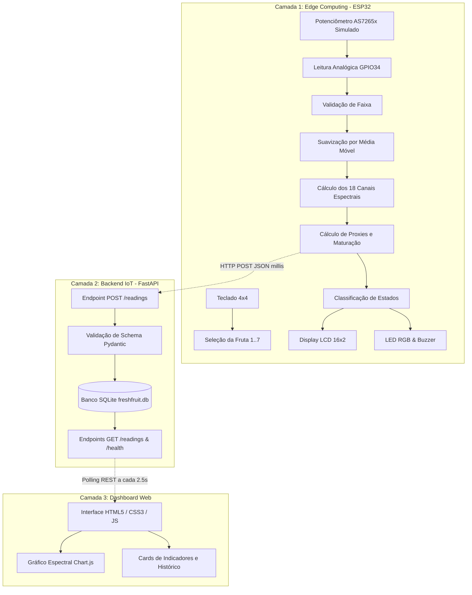

# Fresh Fruit — Monitoramento Espectral Vis-NIR e Maturação de Frutas

> **FIAP · Global Solution 2026.2 · CitizenTech**  
> **Disciplina:** Engenharia de Software  
> **Microcontrolador:** ESP32 DevKit v1  
> **Ambiente de Simulação:** Wokwi  

---

## 👥 Integrantes da Equipe

| Nome Completo | RM |
|---|---|
| **Antonio do Nascimento Ferreira de Sousa** | 573706 |
| **Guilherme Pereira Ruiz da Silva** | 573360 |
| **Gustavo Leal** | 569361 |
| **Matheus Mendes Duarte da Silva** | 569559 |
| **Matheus Sato Oliveira do Prado** | 569392 |

---

## 📖 1. Contextualização do Projeto

### 1.1. O que é o Fresh Fruit?
O **Fresh Fruit** é uma solução IoT baseada em **Edge Computing** que utiliza conceitos de **espectrometria Vis-NIR (Visible and Near-Infrared)** para estimar características físico-químicas relacionadas ao estágio de maturação de frutas.

A solução utiliza um microcontrolador **ESP32** para simular e processar dados espectrais de **18 canais** (baseados nas bandas do sensor multiespectral **AS7265x**, faixa de 410 nm a 940 nm), calculando indicadores heurísticos em tempo real e classificando o estado da fruta de forma 100% autônoma.

### 1.2. Problema que o Projeto Resolve
Feirantes, pequenos comerciantes e consumidores avaliam a qualidade e a maturação das frutas primordialmente por inspeção visual, tato e intuição. Essa abordagem gera desperdício de alimentos, perdas financeiras e divergências de percepção.

O Fresh Fruit democratiza a análise espectral, transformando dados ópticos invisíveis em métricas práticas:
- **Feirantes e Produtores:** Decisão rápida sobre ponto de venda ou precificação dinâmica.
- **Pequenos Comércios:** Organização de estoque e redução de perdas pós-colheita.
- **Cidadãos/Consumidores:** Compreensão clara da vida útil e do momento ideal de consumo.

### 1.3. Conexão com CitizenTech e ODS
O projeto atende diretamente ao pilar **CitizenTech** ao levar tecnologia de ponta e acessível para desafios urbanos cotidianos, priorizando a **autonomia total da borda (Edge Computing)**: o dispositivo continua medindo, calculando e alertando mesmo em locais sem conectividade ou internet.

- **ODS 2 (Fome Zero e Agricultura Sustentável):** Redução de perdas na cadeia de distribuição de alimentos.
- **ODS 12 (Consumo e Produção Responsáveis):** Minimização do desperdício de alimentos perecíveis.

---

## 🔬 2. Fundamentos da Espectrometria e Indicadores

### 2.1. Sensor de Referência: AS7265x (18 Canais)
O sensor de referência AS7265x disponibiliza 18 canais ópticos distribuídos entre o visível e o infravermelho próximo:
`410, 435, 460, 485, 510, 535, 560, 585, 610, 645, 680, 705, 730, 760, 810, 860, 900, 940 nm`

### 2.2. Indicadores Calculados na Borda (ESP32)
1. **Proxy de Clorofila:** Avalia a degradação da clorofila na casca através do ratio entre o pico de absorção em 680 nm e a banda de referência Red-Edge (730 nm).
2. **Proxy de Sólidos Solúveis (°Brix Estimado):** Estima o acúmulo de açúcares naturais a partir de bandas de absorção NIR (810–860 nm).
3. **Proxy de Umidade Relativa (%):** Monitora a perda de turgidez e conteúdo hídrico celular (bandas de 900–940 nm).
4. **Índice Composto de Maturação (0% a 100%):** Ponderação matemática normalizada adaptada para cada fruta.
5. **Estimativa Heurística de Vida Útil (em dias):** Dias restantes estimados até o limite de consumo ideal.

> **⚠️ Limitação Científica:** Os indicadores são estimativas heurísticas demonstrativas educacionais. Em um produto comercial de campo, seriam necessárias calibrações laboratoriais com espectrofotômetros de bancada, controle rigoroso de iluminância e geometria de medição.

---

## 🍓 3. Frutas Contempladas e Teclado 4x4

O sistema permite a seleção instantânea de 7 frutas através do teclado matricial:

| Tecla | Fruta | Faixa Ideal (°Bx) | Clorofila | Vida Útil Máx. |
|:---:|:---|:---:|:---:|:---:|
| **1** | **Banana** | 8.0 – 22.0 | 15.0 – 90.0 | ~7 dias |
| **2** | **Manga** | 7.0 – 18.0 | 20.0 – 85.0 | ~10 dias |
| **3** | **Mamão** | 6.0 – 15.0 | 18.0 – 80.0 | ~8 dias |
| **4** | **Maçã** | 10.0 – 17.0 | 10.0 – 70.0 | ~20 dias |
| **5** | **Uva** | 12.0 – 24.0 | 12.0 – 65.0 | ~12 dias |
| **6** | **Laranja** | 8.0 – 14.0 | 25.0 – 80.0 | ~15 dias |
| **7** | **Abacate** | 4.0 – 10.0 | 30.0 – 95.0 | ~9 dias |
| **#** | **Confirmar Seleção** | Inicia a análise espectral da fruta escolhida |
| **\*** | **Cancelar / Reset** | Retorna ao estado inicial de aguardo |

---

## 🔌 4. Componentes do Circuito e Pinagem

| Componente | Pino do Componente | Pino no ESP32 | Finalidade |
|---|---|---|---|
| **Potenciômetro** | SIG | `GPIO 34` (ADC1_CH6) | Simulador de variação de reflectância espectral |
| **Potenciômetro** | VCC / GND | `3V3` / `GND` | Alimentação |
| **Keypad 4x4 (Linhas)** | R1, R2, R3, R4 | `GPIO 13, 14, 18, 19` | Varredura de linhas do teclado |
| **Keypad 4x4 (Colunas)**| C1, C2, C3, C4 | `GPIO 25, 26, 27, 32` | Varredura de colunas do teclado |
| **LCD 16x2 I2C** | SDA | `GPIO 21` | Linha de dados I2C (Endereço 0x27) |
| **LCD 16x2 I2C** | SCL | `GPIO 22` | Linha de clock I2C |
| **LCD 16x2 I2C** | VCC / GND | `5V` / `GND` | Alimentação do display |
| **LED RGB (Cátodo)** | R (Vermelho) | `GPIO 4` (via 220Ω) | Alerta crítico ou atenção |
| **LED RGB (Cátodo)** | G (Verde) | `GPIO 16` (via 220Ω) | Indicação de condição normal/madura |
| **LED RGB (Cátodo)** | B (Azul) | `GPIO 17` (via 220Ω) | Estado de espera / seleção |
| **LED RGB (Cátodo)** | Cátodo Comum | `GND` | Referência |
| **Buzzer** | POS (+) | `GPIO 23` | Alarme sonoro pulsante no estado crítico |
| **Buzzer** | NEG (-) | `GND` | Referência |

---

## 🏗️ 5. Arquitetura em 3 Camadas



---

## 🚦 6. Lógica de Funcionamento e Estados de Borda

O firmware opera sob máquina de estados não-bloqueante controlada por `millis()`:

1. **Estado Aguardando (IDLE):** LED Azul aceso. LCD solicita seleção de 1 a 7 e tecla `#`.
2. **Estado Normal (NORMAL):** Fruta madura e no ponto ideal de consumo. LED Verde aceso. LCD exibe índice de maturação e °Brix. Buzzer desligado.
3. **Estado de Atenção (ATENÇÃO):** Fruta verde (imaturo) ou muito madura (consumo rápido). LED Amarelo (Vermelho + Verde).
4. **Estado Crítico (CRÍTICO):** Fruta passada / deteriorada. LED Vermelho aceso. Buzzer aciona alarme sonoro pulsante.
5. **Estado de Falha (FALHA):** Leitura fora dos limites operacionais. LED pisca em Magenta.

---

## 🚀 7. Como Executar e Testar o Projeto

O Fresh Fruit utiliza o **Wokwi Simulator integrado ao Visual Studio Code** para simular o circuito eletrônico com ESP32. O backend é executado localmente por meio do FastAPI, enquanto o Dashboard Web consome os dados disponibilizados pela API.

### 7.1. Pré-requisitos

Antes de iniciar, certifique-se de possuir:

- [Visual Studio Code](https://code.visualstudio.com/) instalado.
- Extensão **Wokwi for VS Code** instalada e configurada.
- Python 3.10 ou superior.
- Navegador Web atualizado (Chrome, Edge ou Firefox).
- Projeto Fresh Fruit clonado ou baixado do GitHub.

**Repositório:** https://github.com/gprsilva/FreshFruit

### 7.2. Passo 1 — Abrir o projeto no Visual Studio Code

1. Clone o repositório:

   ```bash
   git clone https://github.com/gprsilva/FreshFruit.git
   ```

2. Abra a pasta `FreshFruit` no Visual Studio Code.
3. Confira se os arquivos `diagram.json`, `sketch.ino` e `wokwi.toml` estão na raiz do projeto.

O arquivo `wokwi.toml` contém as configurações utilizadas pela extensão para localizar o firmware compilado e iniciar a simulação.

### 7.3. Passo 2 — Instalar as dependências do Backend

Abra um terminal integrado no Visual Studio Code, certificando-se de que o diretório atual seja a raiz do projeto `FreshFruit`.

Execute:

```bash
python -m pip install -r backend/requirements.txt
```

Esse comando instala as dependências necessárias para executar a API, incluindo FastAPI, Uvicorn e Pydantic.

### 7.4. Passo 3 — Iniciar o servidor FastAPI

Ainda na raiz do projeto, execute:

```bash
python -m uvicorn backend.main:app --host 127.0.0.1 --port 8000 --reload
```

**Importante:** o comando deve ser executado na raiz do repositório, e não dentro da pasta `backend/`, pois a aplicação utiliza imports relativos entre os módulos.

Após a inicialização, o terminal deverá indicar que o servidor está disponível em:

```text
http://127.0.0.1:8000
```

Para verificar se o backend está funcionando, abra no navegador:

- **Health Check:** http://127.0.0.1:8000/health
- **Documentação interativa:** http://127.0.0.1:8000/docs

O endpoint `/health` deverá retornar informações sobre o estado do serviço e a conexão com o banco SQLite.

**Mantenha esse terminal aberto durante os testes**, pois ele mantém o servidor em execução.

### 7.5. Passo 4 — Abrir o Dashboard Web

Com o backend em execução:

1. Abra a pasta `dashboard/` no explorador de arquivos do projeto.
2. Abra o arquivo `index.html` diretamente no navegador ou utilize a extensão Live Server do VS Code.
3. Verifique o indicador de conexão com o backend.

Quando a comunicação estiver funcionando, o Dashboard deverá apresentar o status de backend conectado.

O Dashboard consulta periodicamente a API para atualizar os indicadores e o histórico de medições.

### 7.6. Passo 5 — Testar o Backend e o Dashboard

Antes de iniciar a simulação do ESP32, é possível verificar a integração entre o backend e o dashboard utilizando o simulador de leituras disponível na própria interface.

1. No Dashboard, localize a opção de simulação de leitura.
2. Escolha uma fruta.
3. Selecione um estágio de maturação.
4. Envie a leitura.
5. Observe a atualização dos indicadores, do gráfico espectral e do histórico.

Essa etapa permite validar o recebimento, a persistência e a apresentação dos dados pela API, independentemente da conexão com o ESP32.

### 7.7. Passo 6 — Executar a simulação do ESP32 no Wokwi

Com o projeto aberto no Visual Studio Code:

1. Abra o arquivo `diagram.json`.
2. Certifique-se de que os arquivos de firmware indicados no `wokwi.toml` estejam disponíveis:
   - `sketch.ino.bin`
   - `sketch.ino.elf`
3. Pressione `F1` ou `Ctrl + Shift + P`.
4. Procure o comando **Wokwi: Start Simulator**.
5. Inicie a simulação.
6. Abra o monitor serial para acompanhar as mensagens do ESP32.

O simulador deverá carregar o circuito com ESP32, teclado matricial, potenciômetro, display LCD, LED RGB e buzzer.

### 7.8. Passo 7 — Realizar os testes de maturação

Com a simulação em execução:

1. Pressione uma tecla de `1` a `7` para selecionar uma fruta.
2. Pressione `#` para confirmar a seleção.
3. Gire o potenciômetro para modificar o valor de entrada utilizado na simulação espectral.
4. Observe as mudanças nos indicadores apresentados no LCD.
5. Verifique as respostas do LED RGB e do buzzer.
6. Acompanhe as informações e os estados registrados no monitor serial.

Exemplo de seleção:

| Tecla | Fruta |
|---|---|
| 1 | Banana |
| 2 | Manga |
| 3 | Mamão |
| 4 | Maçã |
| 5 | Uva |
| 6 | Laranja |
| 7 | Abacate |

A tecla `*` cancela a seleção e retorna o dispositivo ao estado inicial.

### 7.9. Integração e conectividade

O ESP32 foi programado para tentar transmitir as leituras ao backend por HTTP, utilizando o endereço configurado no firmware.

Quando a conexão está disponível, as informações podem ser enviadas à API e armazenadas no banco SQLite.

Caso a conexão Wi-Fi ou a comunicação com o backend não esteja disponível, o dispositivo mantém seu processamento local, incluindo a classificação da maturação e os alertas visuais e sonoros.

**Observação:** o simulador de leituras do Dashboard permite testar a API e a interface separadamente da transmissão do ESP32. Portanto, uma leitura gerada pelo simulador web não deve ser confundida com uma medição recebida diretamente do dispositivo.

### 7.10. Encerramento

Para finalizar os testes:

1. Interrompa a simulação do Wokwi.
2. Retorne ao terminal do backend.
3. Pressione `Ctrl + C` para encerrar o servidor FastAPI.


---

## 📁 Estrutura de Arquivos

```
FreshFruit/
├── diagram.json                 # Diagrama de circuito Wokwi
├── sketch.ino                   # Firmware C++/Arduino para ESP32
├── libraries.txt                # Bibliotecas externas do Wokwi
├── wokwi.toml                   # Configuração de integração Wokwi
├── README.md                    # Documentação principal
├── backend/
│   ├── main.py                  # API FastAPI com rotas REST e CORS
│   ├── schemas.py               # Schemas de validação Pydantic (18 canais)
│   ├── database.py              # DAO SQLite e persistência
│   ├── requirements.txt         # Dependências Python
│   └── .env.example             # Exemplo de configuração de ambiente
├── dashboard/
│   ├── index.html               # Estrutura do dashboard web
│   ├── styles.css               # Folha de estilos moderna e responsiva
│   └── app.js                   # Lógica de consumo da API e Chart.js
└── docs/
    ├── arquitetura.md           # Detalhamento técnico da arquitetura
    └── testes.md                # Matriz de testes e validações
```
