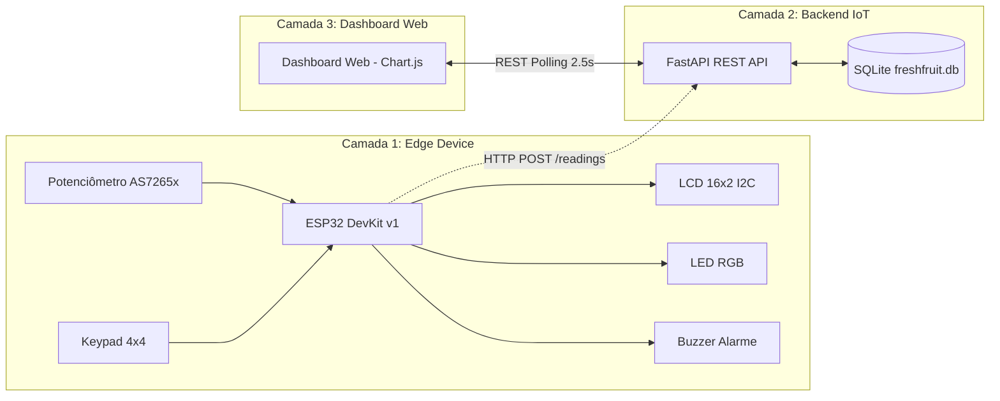

# Documento de Arquitetura de Software e Hardware — Fresh Fruit

> **FIAP · Global Solution 2026.2 · CitizenTech**  
> **Projeto:** Fresh Fruit — Espectrometria Vis-NIR e Maturação de Frutas  

---

## 1. Visão Geral da Arquitetura

O sistema Fresh Fruit adota uma arquitetura distribuída em **3 Camadas**, projetada sob o princípio de **Edge Computing First**: toda a lógica crítica de decisão, medição, cálculo espectral e acionamento de atuadores ocorre localmente no microcontrolador **ESP32**, garantindo total autonomia e resiliência mesmo na ausência de rede.



---

## 2. Detalhamento das Camadas

### 2.1. Camada 1: Dispositivo IoT & Edge Computing (ESP32)
- **Microcontrolador:** ESP32 DevKit v1 (Dual-Core Tensilica Xtensa 32-bit LX6, 240 MHz).
- **Entrada Analógica:** ADC de 12 bits no `GPIO 34` (faixa 0 a 4095).
- **Interface de Entrada:** Teclado Matricial 4x4 (`GPIO 13, 14, 18, 19, 25, 26, 27, 32`).
- **Interfaces de Saída:**
  - Barramento I2C (`SDA=21, SCL=22`) para Display LCD1602 com controlador PCF8574 (Endereço `0x27`).
  - LED RGB Cátodo Comum (`R=4, G=16, B=17`) com resistores de 220Ω.
  - Buzzer Piezoelétrico (`GPIO 23`).
- **Lógica de Temporização:** Uso exclusivo de `millis()` (sem bloqueios no `loop()`).
- **Algoritmos Embarcados:**
  - Validação de limites operacionais.
  - Suavização por média móvel com buffer circular (`SMOOTHING_SAMPLES = 5`).
  - Geração de 18 canais espectrais (AS7265x) com curvas de reflectância baseadas em biomarcadores ópticos.
  - Cálculo de índices: Clorofila (absorção em 680nm), Sólidos Solúveis (°Brix via NIR 810–860nm), Umidade (900–940nm), Maturação (0–100%) e Vida Útil residual.

### 2.2. Camada 2: Backend IoT (FastAPI + SQLite)
- **Framework:** FastAPI (Python 3.10+) com servidor ASGI Uvicorn.
- **Validação de Schemas:** Pydantic V2 para verificação de tipos, intervalos numéricos e garantia de exatos 18 canais no payload.
- **Persistência:** SQLite (`freshfruit.db`), garantindo portabilidade sem necessidade de servidores externos pesados.
- **Segurança:** Suporte a cabeçalho `x-api-key` e CORS configurado.
- **Endpoints:**
  - `GET /health` — Verificação de status e integridade do banco.
  - `GET /fruits` — Catálogo das 7 frutas com limites e metadados.
  - `POST /readings` — Ingestão de medições com validação Pydantic.
  - `GET /readings/latest` — Consulta da última análise para atualização do dashboard.
  - `GET /readings` — Histórico paginado para auditoria e tendências.
  - `DELETE /readings` — Limpeza de histórico para novos ciclos de teste.

### 2.3. Camada 3: Dashboard Web (HTML5 / CSS3 / JS)
- **Tecnologias:** HTML5 semântico, CSS moderno com variáveis e layout responsivo (Grid/Flexbox), JavaScript Vanilla ES6+.
- **Gráficos:** Chart.js com renderização dos 18 canais divididos visualmente em Visível (Azul), Red-Edge (Amarelo) e NIR (Verde).
- **Recursos para o Cidadão:** Indicadores claros em linguagem simples, barra de progresso visual de maturação e estimativa de dias até o consumo limite.

---

## 3. Fluxo de Execução e Resiliência (CitizenTech)

```
[Início]
   │
   ▼
[Inicialização dos Periféricos: LCD, LED, Buzzer, I2C, Serial]
   │
   ▼
[Tentativa de Conexão Wi-Fi (Timeout 2.5s)]
   ├─► Se conectado: Habilita telemetria HTTP
   └─► Se falhar: Registra aviso e continua OPERAÇÃO AUTÔNOMA LOCAL
   │
   ▼
[Loop Principal (millis)]
   ├─► Varredura do Keypad 4x4 (Seleção de fruta 1..7 e confirmação com #)
   ├─► Leitura e Validação do Potenciômetro (GPIO 34)
   ├─► Suavização por Média Móvel
   ├─► Cálculo dos 18 Canais Espectrais
   ├─► Cálculo dos Indicadores (°Brix, Clorofila, Umidade, Vida Útil)
   ├─► Classificação do Estado (Normal / Atenção / Crítico)
   ├─► Atualização do LED RGB e Buzzer
   ├─► Atualização do Display LCD 16x2
   ├─► Telemetria Serial Monitor
   └─► Disparo de requisição POST HTTP não-bloqueante ao Backend
```
